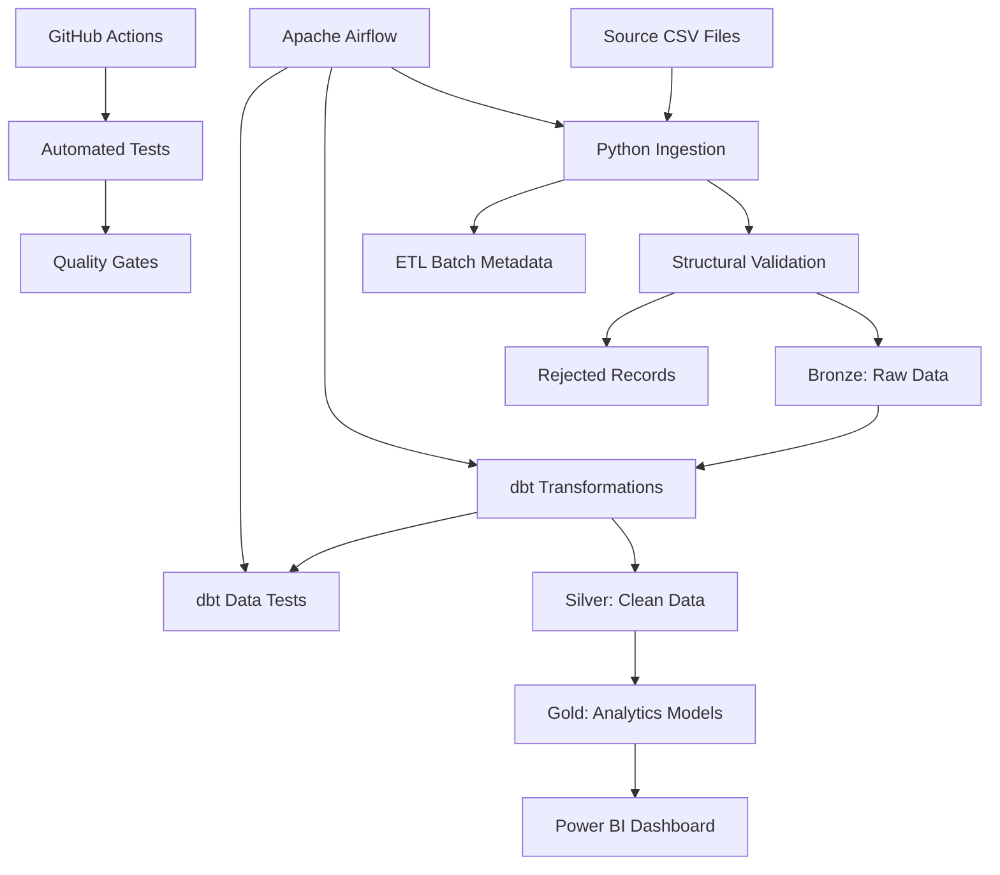

# Supply Chain Data Platform

A portfolio data engineering project that transforms supply chain data into reliable, analytics-ready datasets using Python, PostgreSQL, dbt, Apache Airflow, and Power BI.

## Overview

Supply chain data often arrives in separate files with inconsistent values, missing records, and varying data quality. These problems make operational reporting difficult to maintain and can lead to unreliable business decisions.

The Supply Chain Data Platform aims to automate the ingestion, validation, transformation, and delivery of supply chain data through a reproducible batch processing pipeline.

The platform is designed to demonstrate practical data engineering skills, including ETL/ELT development, relational data modelling, data quality testing, orchestration, containerisation, and continuous integration.

### Business problem

Organisations need reliable information about inventory availability, supplier performance, manufacturing lead times, shipping performance, and product quality. Manually preparing data for reporting can be time-consuming, difficult to reproduce, and vulnerable to data quality issues.

This project addresses that problem by creating a structured pipeline that transforms source data into validated datasets for downstream analytics.

### Primary users

- Procurement teams
- Inventory planners
- Operations managers
- Business analysts

### Project objectives

- Build a repeatable batch ingestion pipeline using Python.
- Store raw data, transformed datasets, and pipeline audit records in PostgreSQL.
- Separate raw, cleaned, and analytics-ready data.
- Implement reusable SQL transformations using dbt.
- Track ingestion batches, record counts, errors, and execution status.
- Detect invalid records and data quality problems.
- Prevent accidental duplicate ingestion when batches are reprocessed.
- Orchestrate pipeline execution using Apache Airflow.
- Automate code quality and testing through GitHub Actions.
- Provide analytics-ready datasets to a Power BI dashboard.

## Architecture

The platform follows a layered data architecture with operational metadata and automated quality checks.



### Data layers

| Layer | Responsibility |
|---|---|
| Bronze | Preserve ingested source data and ingestion metadata for traceability. |
| Silver | Standardise data types, clean values, identify duplicates, and apply documented validation rules. |
| Gold | Provide business-oriented fact tables, dimensions, and metrics for reporting. |
| ETL metadata | Store pipeline execution history, batch status, record counts, and failure details. |

The layered design follows the principles of a medallion architecture, in which data quality and structure improve as information moves downstream.

## Technology stack

| Technology | Responsibility |
|---|---|
| Python | Source extraction, structural validation, ingestion, and error handling |
| PostgreSQL 16 | Raw data storage, warehouse tables, and pipeline metadata |
| dbt | SQL transformations, model dependencies, and data quality tests |
| Apache Airflow 3 | Task orchestration, execution dependencies, retries, and scheduling |
| Docker Compose | Reproducible local development environment |
| pytest | Unit and integration testing |
| Ruff | Python formatting and linting |
| GitHub Actions | Automated CI checks |
| Power BI | Analytics, visualisation, and operational reporting |

## Repository structure

The repository should keep this structure aligned with the actual files committed to GitHub.

```text
supply-chain-data-platform/
│
├── src/
│   └── supply_chain_pipeline/
│       ├── __init__.py
│       ├── cli.py
│       ├── config.py
│       ├── extract.py
│       ├── validate.py
│       ├── load.py
│       ├── manifest.py
│       └── logging_config.py
│
├── sql/
│   └── bootstrap/
│       ├── 000_create_airflow_db.sql
│       ├── 001_create_schemas.sql
│       ├── 002_create_audit_tables.sql
│       └── 003_create_raw_tables.sql
│
├── dbt/
│   ├── dbt_project.yml
│   ├── profiles.yml.example
│   ├── models/
│   │   ├── staging/
│   │   ├── intermediate/
│   │   └── marts/
│   ├── tests/
│   └── seeds/
│
├── dags/
│   └── supply_chain_pipeline.py
│
├── scripts/
│   ├── check_schema_compatibility.py
│   └── check_contract_parity.py
│
├── tests/
│   ├── unit/
│   ├── integration/
│   └── fixtures/
│       └── happy_path.csv
│
├── data/
│   ├── incoming/
│   └── sample/
│
├── docs/
│   ├── architecture.md
│   ├── source-data-contract.md
│   ├── data-dictionary.md
│   ├── data-quality.md
│   ├── metric-definitions.md
│   └── decisions/
│
├── dashboards/
│
├── .github/
│   └── workflows/
│       └── ci.yml
│
├── .env.example
├── .gitignore
├── Dockerfile
├── compose.yaml
├── pyproject.toml
├── requirements-dev.txt
└── README.md
```

Not every directory needs to contain files in the initial version. Add files as the corresponding components are implemented, and ensure the documented structure matches the repository.

## Data sources and assumptions

The pipeline is designed for structured supply chain source files, initially using CSV input.

Before publishing the project, document the actual source dataset and its provenance.

| Item | Documentation required |
|---|---|
| Dataset name | Actual source dataset name |
| Source location | Original URL or documented origin |
| Licence | Applicable usage and redistribution terms |
| Extraction date | When the dataset was obtained |
| Source schema | Columns, types, and expected formats |
| Data limitations | Missing fields, static history, simulated records, or known quality issues |

Do not commit large source datasets or sensitive information to the repository. Small, synthetic test fixtures can be included to demonstrate pipeline behaviour.

The source data contract should document required fields, business keys, expected data types, accepted values, and validation rules.

## Database design

PostgreSQL stores the supply chain data and operational metadata.

The development environment uses separate databases or schemas for their respective responsibilities, as configured in the Compose and bootstrap files.

### Bronze layer

The Bronze layer preserves landed source records and relevant metadata.

Expected metadata includes:

- `batch_id`
- `source_file`
- `source_row_number`
- `source_file_hash`
- `ingested_at`

The exact source columns depend on the source dataset.

### ETL batch tracking

The `etl.batch_runs` table records pipeline execution information, including:

- Batch identifier
- Pipeline name
- Source file and file hash
- Start and finish timestamps
- Execution status
- Rows read, loaded, and rejected
- Error details, where applicable

A separate rejected-record table should retain invalid records or relevant source references and explain why processing failed.

These records support debugging, reconciliation, and safe recovery.

### Silver and Gold layers

The Silver layer standardises source values and prepares them for analysis.

The Gold layer exposes analytics-ready models, potentially including:

- Product or SKU dimensions
- Supplier dimensions
- Location dimensions
- Date dimensions
- Order or order-line facts
- Inventory snapshots, if historical observations are available

The final model design must reflect the actual source data. Table grains, primary keys, foreign keys, and metric definitions should be documented before the models are treated as complete.

## Pipeline implementation

The Python application separates extraction, validation, loading, configuration, and execution.

### Ingestion workflow

1. Discover an incoming source file.
2. Calculate a file hash and identify the input batch.
3. Validate the file structure and required columns.
4. Register the batch in the ETL metadata tables.
5. Load valid source records into the Bronze layer.
6. Record row counts and rejected records.
7. Return an appropriate exit status.
8. Allow transformations and downstream tests to run only when required ingestion steps succeed.

### Reliability requirements

**Idempotency:** reprocessing an unchanged batch must not create unintended duplicate records.

**Incremental ingestion:** subsequent executions should process newly arrived files or changed records where the source supports reliable identification.

**Error handling:** malformed files, invalid records, and database failures must be logged and handled explicitly.

**Auditability:** each execution should have sufficient metadata to establish what was processed, when it ran, and what happened.

**Transactional loading:** database operations should use suitable transaction boundaries to avoid partially committed loads.

**Reprocessing:** reruns should be deliberate and safe. Corrected files and changed business records should be handled according to documented keys and merge rules.

## Transformation workflow with dbt

The dbt project manages SQL transformations and dependencies across the Bronze, Silver, and Gold layers.

### Staging models

Staging models prepare source data for downstream processing by:

- Standardising names.
- Converting data types.
- Normalising formats.
- Handling empty and missing values.
- Applying documented source-level rules.
- Identifying duplicate or invalid records.

### Intermediate models

Intermediate models encapsulate reusable business transformations, such as order-line calculations, lead-time calculations, deduplication rules, and supplier-level aggregations where the source data supports them.

### Gold models

Gold models expose business-oriented data structures designed for reporting and analysis. Their definitions should make it clear what each row represents and how each business metric is calculated.

### Running dbt

The pipeline container should execute dbt from the configured project directory and use the configured PostgreSQL profile.

For a configured local dbt environment:

```powershell
dbt build --project-dir dbt --profiles-dir dbt
```

This command assumes that a valid `profiles.yml` exists in the selected profile directory and that its connection settings are configured correctly.

`dbt build` builds the selected resources and runs their associated tests. A second `dbt test` command is normally unnecessary when the intention is simply to rerun the same tests.

For more information, see the [dbt build command documentation](https://docs.getdbt.com/reference/commands/build).

## Data quality and testing

Data quality is a core part of the platform rather than an optional reporting step.

### Python unit tests

Unit tests validate isolated application behaviour, including:

- File and schema validation.
- Parsing and data type handling.
- File hashing.
- Duplicate detection.
- Configuration validation.
- Error handling.

### Integration tests

Integration tests execute pipeline components against a real PostgreSQL test database.

Scenarios should include:

- Successful ingestion of a valid fixture.
- Repeated submission of the same input file.
- Invalid source structure.
- Invalid individual records.
- Duplicate business keys.
- Corrected records.
- Database connection failures.
- Pipeline recovery after a failure.

### dbt tests

dbt tests should verify appropriate constraints and business rules, including:

- Non-null required keys.
- Unique model keys.
- Valid dimension-to-fact relationships.
- Accepted business status values.
- Reconciliation of loaded and rejected record counts.
- Custom business constraints supported by the data contract.

The rules must reflect the meaning of the actual data. For example, missing values should not automatically be treated as zero, and negative quantities should not be rejected if they legitimately represent returns or adjustments.

## Reproducible development environment

The project uses Docker Compose to provide a repeatable local environment.

### Prerequisites

Install:

- Docker Desktop with Docker Compose v2.
- Git.
- Python 3.11 for the documented local testing environment.
- Power BI Desktop, if you want to open or develop the dashboard.
- Visual Studio Code or another suitable editor.

The development stack uses PostgreSQL 16. Check the pinned dependency versions and compatible service configuration in the repository before changing major versions.

### Environment configuration

From the repository root, create a local environment file:

```powershell
Copy-Item .env.example .env
```

Edit `.env` only when you need to override the documented local defaults, such as passwords or the host-facing PostgreSQL port.

The repository's `.env.example` is the authoritative list of supported configuration variables. Never commit your real `.env` file, credentials, or other secrets.

Ensure the `.gitignore` excludes `.env`, generated database files, unnecessary raw datasets, and local Python environments.

### Services

| Service | Purpose |
|---|---|
| `postgres` | PostgreSQL 16 database server for the warehouse and Airflow metadata database |
| `airflow` | Local Airflow environment for executing and monitoring workflow tasks |
| `pipeline` | Optional one-shot ETL and dbt execution, enabled through the `pipeline` Compose profile |

The pipeline service is intended to run to completion and propagate a failure through a non-zero exit code.

Containers communicate using Compose service names. For example, the PostgreSQL hostname inside the Compose network is `postgres`, not `localhost`.

The optional host port setting, such as `HOST_POSTGRES_PORT`, controls the port exposed to applications running directly on the host. It does not change PostgreSQL's internal container port.

### Start the environment

Build the application images and start the standard services:

```powershell
docker compose up --build
```

Check the container status in another terminal:

```powershell
docker compose ps
```

Inspect logs when a service does not start correctly:

```powershell
docker compose logs postgres
docker compose logs airflow
```

The Compose configuration should use a PostgreSQL health check and wait for the database to become healthy before dependent services start.

### Run one complete batch

With the required database services available, run the one-shot pipeline:

```powershell
docker compose --profile pipeline run --rm pipeline
```

The container should perform the configured ingestion process and dbt build, then exit.

Check the exit code immediately:

```powershell
$LASTEXITCODE
```

A successful execution returns `0`. A failed ingestion or required transformation/test step should return a non-zero exit code.

### Run the unit test suite locally

Create a Python environment:

```powershell
py -3.11 -m venv .venv
```

Install development dependencies:

```powershell
.\.venv\Scripts\python.exe -m pip install -r requirements-dev.txt
```

Run formatting checks and linting:

```powershell
.\.venv\Scripts\ruff.exe format --check src tests scripts
.\.venv\Scripts\ruff.exe check src tests scripts
```

Run the unit tests:

```powershell
.\.venv\Scripts\python.exe -m pytest
```

Integration tests require the appropriate PostgreSQL test database and environment configuration.

### Stop the environment

Stop the containers while preserving the database volume:

```powershell
docker compose down
```

Reset the environment by deleting the Compose-managed volumes:

```powershell
docker compose down -v
docker compose up --build
```

**Warning:** `docker compose down -v` deletes the associated persistent volumes, including local database data. Use it only when you intentionally want a fresh environment.

## Database initialisation

The bootstrap SQL files establish the required databases, schemas, and tables for a fresh local environment.

The PostgreSQL Docker image runs its `/docker-entrypoint-initdb.d/` scripts only when the data directory is initially empty. Changes to bootstrap files will not automatically be applied to an already initialised persistent volume.

Use an explicit migration or schema-update process when modifying an existing environment. A complete local reset is appropriate for development when losing the existing database is acceptable.

See the [official PostgreSQL Docker image documentation](https://hub.docker.com/_/postgres) for initialisation behaviour.

## Apache Airflow orchestration

Airflow coordinates the pipeline tasks and makes execution status observable.

The DAG is expected to control the sequence of:

1. Source discovery.
2. Ingestion and source validation.
3. Bronze loading.
4. dbt transformations.
5. Data quality checks.
6. Batch completion reporting.

The DAG should call the same tested application and dbt logic used by the one-shot pipeline rather than implementing a second, separate transformation process.

Configure task dependencies, execution timeouts, retries for suitable transient failures, and useful task logging.

The Airflow container must have the DAG, required dependencies, connection configuration, and access to the pipeline code it executes.

For this project, Airflow is a local development and portfolio orchestration environment, not a claim of production deployment.

Airflow's metadata connection must be explicitly configured for the intended PostgreSQL database. Standalone mode without a configured backend can use SQLite, which is intended for development rather than a multi-component production-style deployment.

See the [Airflow database backend guide](https://airflow.apache.org/docs/apache-airflow/stable/howto/set-up-database.html) for configuration details.

## Continuous integration with GitHub Actions

The workflow in `.github/workflows/ci.yml` is validation-only. It runs checks on pushes to `main` and pull requests.

It does not schedule recurring data ingestion. Local orchestration belongs to Airflow, while the one-shot execution command remains available for development and debugging.

### CI pipeline

The workflow should perform these checks:

1. Set up Python 3.11 and install pinned development dependencies.
2. Run Ruff formatting and lint checks.
3. Run the Python unit tests.
4. Check compatibility between loader columns and the Bronze database schema.
5. Check that documented contracts remain consistent with implemented behaviour.
6. Initialise the PostgreSQL test environment.
7. Run the integration test suite against PostgreSQL.
8. Ingest the happy-path fixture and execute the dbt build and associated tests.

The exact bootstrap commands must match the SQL files in the repository. The workflow must initialise every database and schema required by the tests.

### Quality gates

| Gate | Command or action | Failure condition |
|---|---|---|
| Formatting | `ruff format --check src tests scripts` | Formatting differs from the configured standard |
| Linting | `ruff check src tests scripts` | Code-quality violations |
| Unit tests | `python -m pytest` | Unit-test failure |
| Schema compatibility | `python scripts/check_schema_compatibility.py` | Loader and database definitions diverge |
| Contract parity | `python scripts/check_contract_parity.py` | Documentation conflicts with implemented behaviour |
| Integration tests | `python -m pytest -m integration` | Pipeline fails against the test database |
| dbt validation | `dbt build` | A required model or associated test fails |

Each check should be a distinct CI step so that GitHub Actions identifies the failing gate clearly.

The local CI checks can be reproduced from the repository root, provided the test environment and database configuration are available:

```powershell
python -m pip install -r requirements-dev.txt

ruff format --check src tests scripts
ruff check src tests scripts

python -m pytest

python scripts/check_schema_compatibility.py
python scripts/check_contract_parity.py
```

Integration and dbt checks require the configured database environment.

## Power BI dashboard

The dashboard presents supply chain performance using the curated data made available by the platform.

[Open the Supply Chain Dashboard on SharePoint](https://ufs4lifeacza-my.sharepoint.com/:u:/g/personal/2020085235_ufs4life_ac_za/IQDMU34pS5b-SoCXk5sw38CVAfJOq5SkjL5FAuN61K56B7w?e=9mGsh1)

Access to the SharePoint resource may require an authorised account.

### Suggested reporting areas

- **Executive overview:** supported business KPIs and operational trends.
- **SKU and product performance:** availability, quality results, and supported product comparisons.
- **Manufacturing and shipping:** lead-time comparisons using documented field definitions.
- **Inspection quality:** Pass, Fail, and Pending inspection results.
- **Supplier and location analysis:** comparisons where appropriate source dimensions are available.

Candidate metrics include average manufacturing lead time, average shipping time, average defect rate, availability, and inspection pass rate. Their definitions and units must be confirmed against the actual source data.

The report should reconcile to independent SQL results. A dashboard measure should not silently change its business meaning through formatting or undocumented calculations.

## Security and data management

- Keep credentials and secrets out of Git.
- Use `.env.example` for documented variable names without real credentials.
- Do not commit sensitive production data.
- Include only data that can legally and appropriately be redistributed.
- Use small synthetic fixtures for automated testing.
- Exclude unnecessary local environments, caches, logs, and generated files.
- Do not embed database passwords in Python modules, SQL scripts, or dbt profiles.

## Troubleshooting

### PostgreSQL port conflict

If local PostgreSQL is already using the host port configured for the Compose service, change the documented host port variable in `.env`.

Containers should continue connecting to the database using the service hostname and internal port.

### Bootstrap changes are not applied

Initialisation scripts execute only when the PostgreSQL data directory is empty. Use a suitable schema migration for an existing database, or reset the local volume when a destructive clean start is appropriate.

### Pipeline exits with a non-zero code

Inspect the pipeline logs and the recorded ETL batch status. Check whether the failure occurred during file validation, raw-data loading, dbt model execution, or data-quality testing.

Do not mark a failed batch as successful simply to make a command exit cleanly.

### dbt connection failure

Verify the selected profile, configured target, hostname, port, database name, and credentials.

When running inside Docker Compose, use the configured database service hostname. When running directly on Windows, use the host-facing port.

### Integration tests fail

Confirm that PostgreSQL is healthy, the correct test database has been initialised, the bootstrap scripts have run, and the test environment variables point to that database.

### Airflow cannot execute pipeline tasks

Check the DAG's availability, its imports, the installed dependencies, PostgreSQL metadata configuration, and connectivity from the Airflow container to the pipeline and warehouse services.

## Project documentation

The `docs/` directory should provide supporting documentation for:

- System architecture and component responsibilities.
- Source-data contracts and schema definitions.
- Data dictionary and business terminology.
- Data quality rules and rejected-record handling.
- Metric definitions and calculation rules.
- Engineering decisions and known limitations.

Architecture diagrams, dashboard screenshots, test results, and sample pipeline logs should be included where they help a reviewer understand and verify the implementation.

## Development roadmap

The project can be developed incrementally in the following order:

1. Audit the source dataset and establish the data contract.
2. Create the PostgreSQL schemas and audit tables.
3. Implement Python ingestion and batch tracking.
4. Add idempotency, error handling, and incremental ingestion.
5. Build Silver transformations and the Gold warehouse with dbt.
6. Add data quality and integration tests.
7. Integrate Airflow orchestration.
8. Containerise and document the local environment.
9. Add and validate GitHub Actions quality gates.
10. Complete the Power BI report, architecture documentation, and reproducibility checks.

Future extensions may include cloud deployment, additional source connectors, historical supplier attribute tracking, and large-scale processing if the business requirements justify them.

## Success criteria

The platform should be considered portfolio-ready when:

- A clean environment can be set up using documented instructions.
- A valid batch can be loaded reproducibly.
- Reprocessing does not create unintended duplicates.
- Invalid input and failures are traceable.
- Raw and transformed records can be reconciled.
- Warehouse models have documented grains, keys, and metric definitions.
- Automated tests pass in the documented environment.
- Airflow can execute the pipeline with visible task status.
- The GitHub Actions workflow validates code changes.
- The Power BI dashboard reconciles to the warehouse.
- Another developer can understand the architecture and reproduce the demonstrated results.

## Learning references

- [PostgreSQL Docker image](https://hub.docker.com/_/postgres)
- [Apache Airflow documentation](https://airflow.apache.org/docs/apache-airflow/stable/)
- [Airflow database configuration](https://airflow.apache.org/docs/apache-airflow/stable/howto/set-up-database.html)
- [dbt build command](https://docs.getdbt.com/reference/commands/build)
- [dbt data tests](https://docs.getdbt.com/docs/build/data-tests)
- [Docker Compose documentation](https://docs.docker.com/compose/)
- [Power BI PostgreSQL connector](https://learn.microsoft.com/en-us/power-query/connectors/postgresql)
- [GitHub Actions documentation](https://docs.github.com/en/actions)

## About the project

The Supply Chain Data Platform is a portfolio project focused on developing practical data engineering capabilities through pipeline implementation, relational data modelling, data quality, orchestration, automation, and business reporting.

The goal is to demonstrate not only how to analyse data, but also how to build a repeatable process that makes data more reliable and useful for business decisions.
